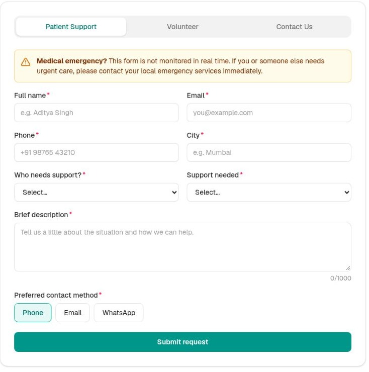
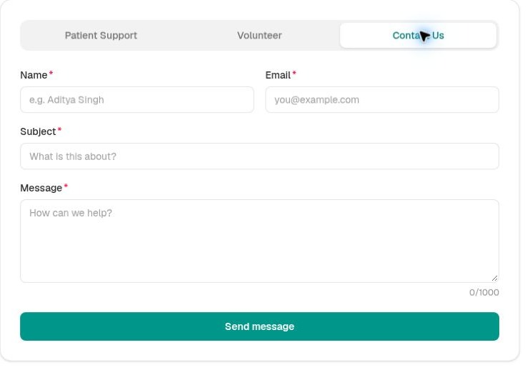
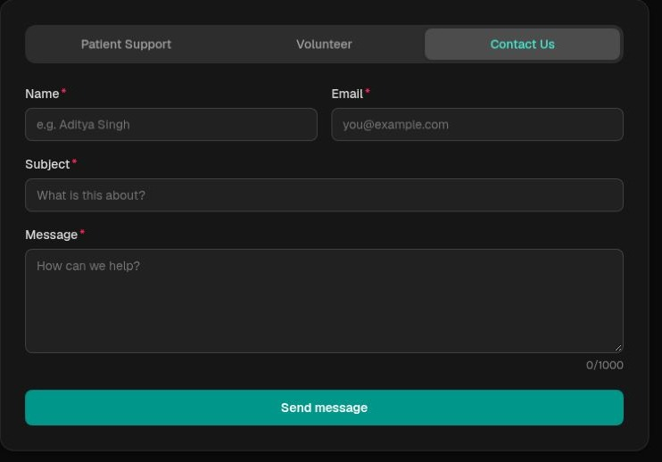

# CareConnect

[](https://careconnect-jc.vercel.app/)


**Healthcare support requests, volunteer registration, and an AI-powered information assistant in one portal.**

CareConnect is a full-stack web application built with Next.js and TypeScript. It provides validated forms for patient support, volunteering, and general inquiries, stores submissions in Supabase, and uses Google Gemini to power CareBot.

Maintained by [Sunny Kumar](https://github.com/whysoosunny).

> Demonstration project: the dashboard is public, so use sample data only. CareConnect does not provide medical care or guarantee access to support services.

**[Open live demo](https://careconnect-jc.vercel.app/)** · [Screenshots](#screenshots) · [Features](#features) · [Setup](#run-locally) · [Architecture](#architecture)

## Live demo

Explore the application at **[careconnect-jc.vercel.app](https://careconnect-jc.vercel.app/)**.

The deployment currently shows an earlier branding version. The source on `main` contains the updated CareConnect branding; redeploy that branch to bring the live site into sync.

## Screenshots

Interface captures from the live application. Images are cropped to the form panels and contain no submitted user data.

### Patient support


| Contact form — light theme | Contact form — dark theme |
| --- | --- |
|  |  |

## Features

- **Patient Support form** - name, email, phone, city, patient type, support needed, description with a live character counter, and preferred contact method. Client and server validation, an emergency banner, and an auto-response with a reference ID (e.g. `CB-1042`).
- **CareBot, the AI FAQ assistant** - a floating chat widget on every page. Answers questions about portal features, support requests, volunteering, and contact options. Powered by Gemini Flash, grounded on a knowledge base, and clearly labelled informational, not medical advice.
- **Volunteer and Contact forms** - same validated pattern and API.
- **Submissions dashboard** (`/dashboard`) - stat tiles, bar charts of requests by type and support category, and a recent-submissions table. Unauthenticated (demo only, see limitations).

## Tech stack

| Layer | Choice |
|------|--------|
| Framework | Next.js 16 (App Router) + React 19 + TypeScript |
| Styling | Tailwind CSS v4 + `@tailwindcss/typography` |
| Forms | react-hook-form + zod (shared schema, client and server) |
| AI | Google Gemini via `@google/genai` (`gemini-2.5-flash`) |
| Data | Supabase (Postgres) via `@supabase/supabase-js` |
| Icons / Markdown | `lucide-react`, `react-markdown` |
| Hosting | Vercel |

## Architecture

1. Forms send validated input to POST /api/submit.
2. The route checks a honeypot field, validates again with Zod, and stores the submission in Supabase.
3. POST /api/chat applies an in-memory rate limit and a medical-intent guard before calling Gemini.
4. CareBot uses content/knowledge.md as its factual context.
5. The server-rendered /dashboard displays counts, charts, and recent submissions from the latest 200 records.

Credentials stay on the server. Server-side key handling does not replace authentication or database access policies.

Support categories describe requests users can submit, not verified services. Confirmations appear in the browser; the app does not send email, SMS, or WhatsApp notifications or promise a response time.

## Project structure

| Directory | Purpose |
| --- | --- |
| `src/app` | Pages, application layout, and API routes |
| `src/components` | Forms, chat widget, dashboard charts, and shared UI |
| `src/hooks` | Chat state and browser history management |
| `src/lib` | Shared schemas, types, and submission helpers |
| `src/server` | Gemini integration, Supabase client, and medical-intent checks |
| `content` | CareBot knowledge base |
| `screenshots` | Interface screenshots used in this README |

## Run locally

Requires Node.js 20.9 or later and npm.

```bash
git clone https://github.com/whysoosunny/careConnect.git
cd careConnect
npm ci
cp .env.example .env.local   # then fill in the three values
npm run dev                  # http://localhost:3000
```

On Windows Command Prompt, use `copy .env.example .env.local` instead of `cp`.

### Environment variables (all server-side, no `NEXT_PUBLIC_`)

```
GEMINI_API_KEY=     # free key from https://aistudio.google.com/apikey
SUPABASE_URL=       # Supabase, Project Settings > API
SUPABASE_ANON_KEY=  # Supabase, Project Settings > API (anon/public key)
```

### Supabase setup (SQL)

Create a demo project, then run this in the SQL editor. These policies allow anonymous reads and inserts: use synthetic data only. Protect the dashboard and restrict database policies before collecting real information:

```sql
create table if not exists submissions (
  id uuid primary key default gen_random_uuid(),
  kind text not null,
  name text,
  email text,
  phone text,
  payload jsonb,
  created_at timestamptz not null default now()
);

alter table submissions enable row level security;

-- Base table privileges for the anon role (needed because we did NOT enable
-- "Automatically expose new tables" when creating the project).
grant insert, select on table public.submissions to anon;

-- Anon may INSERT (forms, via the server route) and SELECT (the demo /dashboard).
-- Both happen server-side; the anon key never reaches the browser. In production the
-- dashboard would be auth-gated and this SELECT policy removed.
create policy "anon can insert" on submissions
  for insert to anon with check (true);

create policy "anon can read" on submissions
  for select to anon using (true);
```

## Validation

Run `npm run lint`, `npx tsc --noEmit`, and `npm run build` before deployment. Use `npm start` to serve a production build.

## Deploy to Vercel

1. Push this repo to GitHub.
2. Import it on [Vercel](https://vercel.com/new) (Next.js is auto-detected).
3. Add the three environment variables (same as `.env.local`).
4. Deploy. You get a live URL. Test that `/api/chat` responds and a form submission lands in Supabase.

## Current limitations

- The dashboard and demo database policies are unauthenticated. Use sample data only.
- Rate limiting runs in memory per server instance.
- CareBot is informational; the pattern-based medical-intent guard cannot catch every clinical question.
- No appointments, document uploads, payments, donations, or outbound notifications are implemented.
- Reference IDs are random four-digit values and can collide.

## Planned improvements

- Authenticated staff access and restrictive database policies.
- Submission status tracking and durable reference IDs.
- Shared rate limiting and automated workflow tests.

## Project feedback

Report bugs and suggest features through [GitHub Issues](https://github.com/whysoosunny/careConnect/issues). Do not include private patient information.
